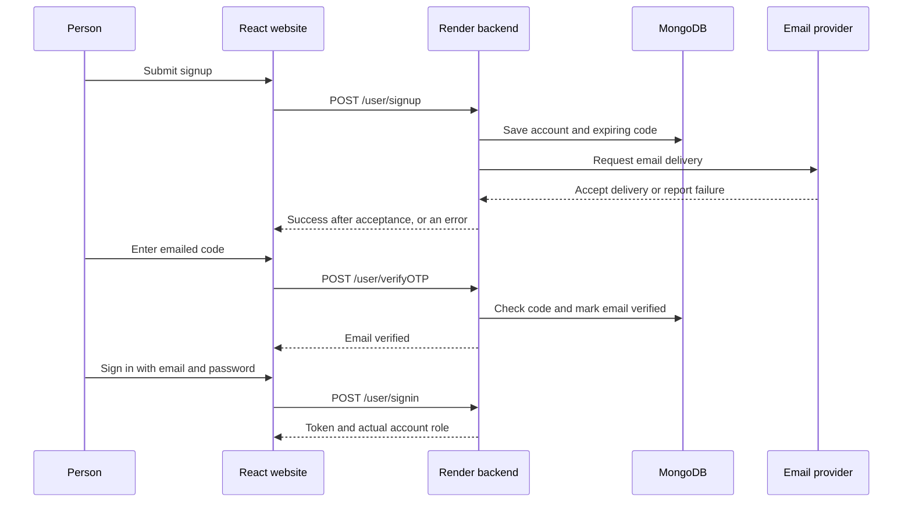

# Fix OTP email delivery and connect authentication

This guide covers the backend work needed when signup opens the code screen but no email arrives. For the complete website guide, start with [README.md](./README.md).

## 1. Understand which application does what

The React website sends your form details to the API. The **backend** creates the code, saves it in MongoDB, and asks an email provider to deliver it. The website cannot send that backend code by itself.



An email provider accepting a request does not guarantee that the message reached the inbox. Check provider delivery events and spam folders as well.

## 2. What was found in the backend

The backend repository reviewed was [`Mekah09/fullstack-ecommerce2`](https://github.com/Mekah09/fullstack-ecommerce2), commit `ed5d74e`.

| Finding | What happens |
| --- | --- |
| `newUser.save()` and `sendEmail()` are not awaited | Signup can return success before the account is saved or email sending fails. A rejected email promise can escape the handler. |
| Gmail SMTP uses port 465 | Missing Gmail credentials, an invalid App Password, or a host blocking SMTP can prevent delivery. |
| Verification uses undefined `User.findOne` | Even a correct email code cannot be checked successfully. The imported model is `Auth`. |
| OTP has a globally unique database index | Different users can collide on a code. Clearing the code can also cause duplicate-key errors with a non-sparse unique index. |
| There is no resend route | A failed or lost email has no dedicated recovery request. |
| Signup hardcodes the buyer role | Choosing seller cannot create a seller account until the backend accepts the requested role. |

The frontend now rejects explicit API failure responses and stops waiting after 90 seconds, including when the response body hangs. Those changes improve error handling; **email delivery still needs the backend repair and provider configuration below**.

## 3. Apply the included backend repair

The ready-to-apply file is [docs/backend-otp.patch](./docs/backend-otp.patch). It changes backend source code; it is **not executed by the React website and has not been deployed to Render**.

The patch waits for saving and email acceptance before signup succeeds, fixes verification, adds expiring six-digit codes and resend, accepts buyer/seller roles, and keeps the admin users route protected. Existing sign-in tokens and product routes keep their current contracts.

1. Open a terminal in a folder where you can keep both projects next to each other.
2. Clone the frontend and backend if you do not already have them:

   ```sh
   git clone https://github.com/Mekah09/fullstack-ecommerce.git
   git clone https://github.com/Mekah09/fullstack-ecommerce2.git
   ```

3. If you already cloned the frontend, update it first so it contains this patch. Preserve or commit your own work before updating either repository.
4. Open the backend folder and apply the patch on a branch:

   ```sh
   cd fullstack-ecommerce2
   git pull --ff-only
   git switch -c fix/otp-delivery
   git apply --check ../fullstack-ecommerce/docs/backend-otp.patch
   git apply ../fullstack-ecommerce/docs/backend-otp.patch
   git diff --check
   ```

   If the check reports a conflict, stop and compare the changed backend files. The patch was prepared against `ed5d74e`; do not overwrite newer work to force it to apply.

5. Review the changes in `controller/auth.controller.js`, `service/mail.js`, `models/Auth.model.js`, and `routes/auth.route.js`.
6. Check syntax:

   ```sh
   node --check controller/auth.controller.js
   node --check service/mail.js
   node --check models/Auth.model.js
   node --check routes/auth.route.js
   ```

7. Follow the email and database steps below before calling the signup problem resolved. Applying a patch locally does not change the deployed API.

## 4. Configure email on Render

### Recommended for Render: send through HTTPS

The patch supports the Resend HTTP API, which uses HTTPS instead of an SMTP port. Other email providers need an equivalent backend adapter; a frontend setting cannot change the backend email service.

1. Create an account with [Resend](https://resend.com/).
2. Add a domain you control in the provider dashboard. Add its requested DNS records and wait until the domain is verified.
3. Choose a sender on that domain, such as `Nook <accounts@your-verified-domain.com>`.
4. Create an API key with permission to send email.
5. Open **Render → your backend web service → Environment**. Add the following backend settings:

   | Name | Value to enter securely |
   | --- | --- |
   | `MAIL_TRANSPORT` | `resend` |
   | `RESEND_API_KEY` | Your email provider API key |
   | `EMAIL_FROM` | Your sender address on the verified domain |

6. Save the settings and deploy the repaired backend.

Do not use the example domain literally. A provider's test sender may only deliver to the account owner's address; it is not a general sender for all buyers and sellers. Confirm sender/domain restrictions in the provider dashboard before testing with other recipients.

Put these settings on the **backend service in Render**. Do not put `RESEND_API_KEY`, `EMAIL_PASS`, MongoDB credentials, or `JWT_SECRET` in Vercel's frontend settings or any `VITE_*` variable.

### Alternative: keep Gmail SMTP where your host supports it

1. Enable two-step verification on the Gmail account used to send messages.
2. Create a Gmail App Password if the account supports it. Use that App Password rather than your normal Gmail password.
3. Set these backend variables:

   | Name | Value |
   | --- | --- |
   | `MAIL_TRANSPORT` | `smtp` |
   | `EMAIL_USER` | The sending Gmail address |
   | `EMAIL_PASS` | Its App Password, entered securely |
   | `EMAIL_FROM` | The same authorized sender, optionally with the Nook display name |
   | `SMTP_HOST` | `smtp.gmail.com` |
   | `SMTP_PORT` | `465` |

4. Redeploy and check the Render logs for connection/authentication failures.

Render Free web services have SMTP restrictions on ports such as 25, 465, and 587. If SMTP times out, check your plan and [Render's current free-service limits](https://render.com/docs/free), then use the HTTPS option or a service that supports outbound SMTP. The actual Render plan and email settings were not available for inspection here.

### Read the backend email error code

The repaired handler returns a useful failure message to the form and records an error code in Render logs. It does not print your email password, API key, or verification code.

| Log code | What to check |
| --- | --- |
| `MAIL_CONFIG` | Missing sender/provider settings or an unsupported `MAIL_TRANSPORT` value |
| `MAIL_PROVIDER_401` or `MAIL_PROVIDER_403` | Provider API key and its sending permissions |
| `MAIL_PROVIDER_422` | Sender, domain, recipient, and message restrictions in the provider dashboard |
| `MAIL_PROVIDER_RESPONSE` | Provider response did not contain the expected accepted-message ID |
| `MAIL_TIMEOUT` or `MAIL_NETWORK` | Email service connectivity and provider status |
| SMTP `EAUTH` | Gmail account/App Password or other SMTP authentication settings |
| SMTP `ETIMEDOUT` | Host SMTP restrictions, connection settings, and provider availability |

### Other backend settings to keep

The reviewed project uses `MONGODB_URL` for MongoDB and `JWT_SECRET` for login tokens. Keep their existing valid values. Product uploads also use `CLOUDINARY_CLOUD_NAME`, `CLOUDINARY_API_KEY`, and `CLOUDINARY_API_SECRET`. Render supplies `PORT`; use `node server.js` as the production start command and the backend's supported Node.js runtime. The patch needs Node.js with built-in `fetch`; Node.js 22.13+ or 24 is suitable for this project.

## 5. Remove the old unique OTP index carefully

Removing `unique: true` from the Mongoose schema does not automatically remove an existing MongoDB index.

1. Open the correct project and database in MongoDB Atlas.
2. Open the authentication collection. Mongoose's `Auth` model normally uses the `auths` collection; confirm the collection name in your database.
3. Open **Indexes** and locate the index on `otp`.
4. Confirm that its key is `{ otp: 1 }`, its name is normally `otp_1`, and it is the unwanted unique OTP index.
5. Remove only that OTP index. Keep `_id` and unrelated indexes. This removes an index, not the user accounts.

If you use `mongosh`, inspect first:

```js
db.auths.getIndexes()
```

Only after confirming the name and key in your database, remove that index:

```js
db.auths.dropIndex("otp_1")
```

The patch does not delete accounts or automatically alter production indexes. Review existing duplicate email accounts separately; it does not merge old accounts or create a unique email index. Concurrent signup requests can still create duplicate email records without a database uniqueness constraint. Before adding a unique email index, use a reviewed migration to resolve existing duplicates and normalize email values; do not delete accounts blindly. The repair's lookups remain compatible with older mixed-case email addresses. Old pending codes have no new expiry timestamp, so request a fresh code through resend after deployment.

## 6. Deploy the backend and enable resend in the frontend

1. In the backend repository, commit and push the reviewed repair branch:

   ```sh
   git add controller/auth.controller.js service/mail.js models/Auth.model.js routes/auth.route.js
   git commit -m "Fix signup email delivery and OTP verification"
   git push -u origin fix/otp-delivery
   ```

2. Merge the backend branch into the branch Render deploys. Check the Render service's Git branch and deployed commit instead of assuming that a frontend deployment also updates the backend.
3. In Render, deploy the backend's latest commit with the email settings from step 4.
4. Confirm that these backend routes exist after deployment:

   | Method | URL | Request |
   | --- | --- | --- |
   | POST | `https://fullstack-ecommerce2.onrender.com/user/signup` | `{ name, email, password, role }` |
   | POST | `https://fullstack-ecommerce2.onrender.com/user/verifyOTP` | `{ email, otp }` |
   | POST | `https://fullstack-ecommerce2.onrender.com/user/signin` | `{ email, password }` |
   | POST | `https://fullstack-ecommerce2.onrender.com/user/resendOTP` | `{ email }` |

5. Only once the new resend route is deployed, open **Vercel → frontend project → Settings → Environment Variables** and set:

   ```dotenv
   VITE_AUTH_RESEND_OTP_URL=/account-api/resendOTP
   ```

6. Apply it to the deployment environments you use and redeploy the frontend. For local development, add it to the frontend's ignored `.env.local` and restart Vite.
7. The frontend's `vite.config.js` and `vercel.json` now map that resend path to `/user/resendOTP`. The button remains unavailable until the public URL setting is supplied.

The other three authentication routes already have working URL defaults. You do not need a secret API key in the React project to call them. A different frontend host needs equivalent proxies or the complete public backend URLs with working CORS.

## 7. Test one complete signup yourself

Use an email inbox you control. These steps send real email when you run them against the deployed backend.

1. Open the deployed website and choose **Join Nook** or **Become a seller**.
2. Enter your name, email, and password, then submit once.
3. In browser Developer Tools → **Network**, find the signup POST. Its response should succeed only after the backend email provider accepts the request. On failure, read the message and check Render logs before retrying.
4. Check the email provider's delivery events for that recipient. Check the inbox, Spam/Junk, and any Promotions folder. Check the spelling of the email shown on the OTP screen.
5. Enter the latest six-digit code. With the repair applied, a code expires after ten minutes and has a limited number of verification attempts.
6. A successful verification returns you to sign-in with your email filled in. Enter your password again. The website does not keep your signup password while you verify.
7. A buyer opens `/account`; a seller opens `/seller`. The role comes from the sign-in response.
8. To test recovery, use an unverified account and choose **Verify your email** from sign-in, then **Resend code**. Resend is limited to one request per minute. Use the newest email's code.

If signup saved the account but email failed, the account may already exist. **Do not keep creating it again.** Open sign-in, enter that email, choose **Verify your email**, and request a new code once resend is enabled. Resend must not reset the account password or change its role.

## 8. Understand the result before debugging the next step

| What you observe | Next action |
| --- | --- |
| Signup fails or says email could not be sent | Check Render logs and backend email settings. The frontend cannot fix a rejected provider request. |
| Signup succeeds but no email arrives | Inspect provider delivery/bounce/suppression events and sender/domain restrictions, then check Spam/Junk. Acceptance is not proof of inbox delivery. |
| SMTP connection times out | Check the hosting plan and outbound SMTP policy; use HTTPS delivery where SMTP is blocked. |
| Provider says sender/domain is unverified | Finish provider DNS/sender verification or use an authorized sender. |
| Account already exists | Sign in if verified; otherwise use the existing-email verification and resend flow. |
| Verification returns 500 | Confirm that Render deployed the repair using `Auth.findOne`, then inspect logs and the old OTP index. |
| Code is invalid or expired | Use the latest code for that email. Request a fresh one after the resend cooldown. |
| Resend button is unavailable | Deploy `/user/resendOTP`, set `VITE_AUTH_RESEND_OTP_URL`, and rebuild/redeploy the frontend. |
| API response is an HTML website | Check proxy order in `vercel.json`, the exact route spelling `verifyOTP`, and which commit Vercel deployed. |
| The form times out | Check Render startup, database access, and email-provider timeouts. Inspect the previous request before resubmitting because the server may have completed it. |

## 9. Get access to admin

1. Fix and deploy authentication first, then register and verify the account you will use as the store owner.
2. In MongoDB Atlas, find that exact account in the authentication collection by its email. Confirm it is your account and not a duplicate record.
3. Change its `role` from `user` to `admin`. Keep `verified: true` and `isActive: true`. Do not replace its password hash with a plain password.
4. Save the database change.
5. Sign out of the website and sign in again so the backend returns the updated role.
6. Open **https://nook-pearl-six.vercel.app/admin**. The admin upload page is `/admin/add-product`.

There is no public admin signup or special frontend admin password. Public signup accepts only buyer (`user`) and seller roles after the repair. The backend must check the current account role for every protected API; changing browser storage is not authorization. The patch removes the public `/allusers` route so that only the route using `protect` and `allowRoles("admin")` remains.

## What has and has not been completed here

The frontend error handling, authentication proxies, repair patch, and instructions are included in this repository. Lint and the production build passed. Nine frontend browser scenarios and 48 backend scenarios passed using mocked network, database, and mail responses. The patch was applied to a clean copy of the reviewed backend and reproduced the tested files exactly; syntax checks passed for all four changed backend files.

No real account, email, production database change, Render deployment, or provider credential setup is performed by these files. Complete the deployment and inbox test above before treating real email delivery as verified.
